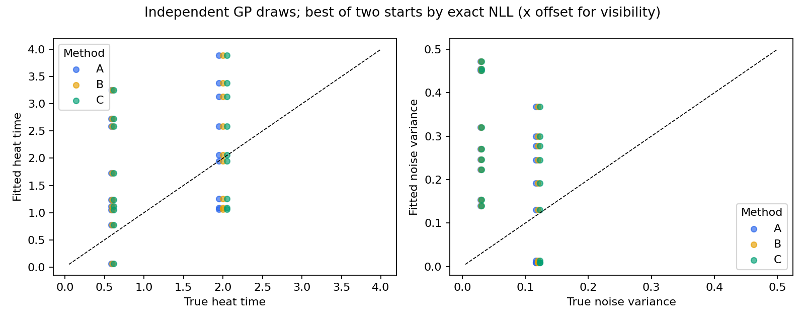
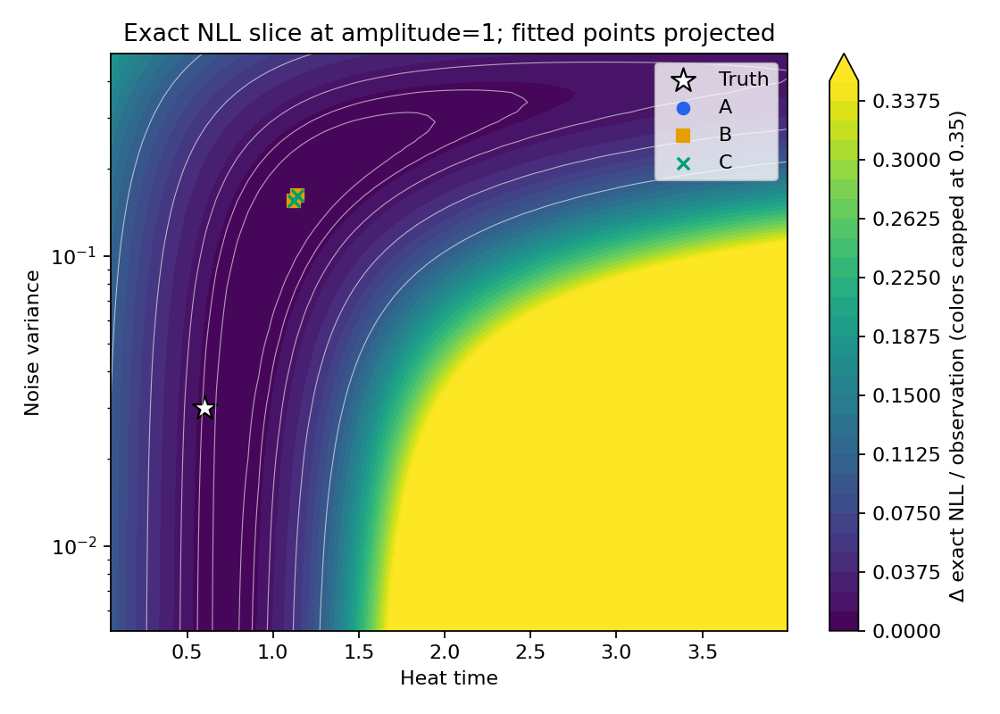
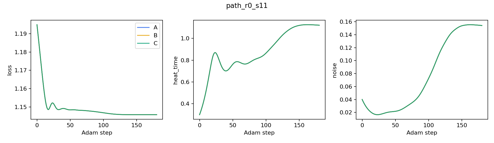

# Experiment 01: numerical agreement, limited parameter recovery

The new implementation reproduces dense GP semantics to high accuracy. These
small datasets **do not establish reliable heat-time/noise recovery**. Dense exact
and sparse fits miss the generating parameters together; the main discrepancy
is not Chebyshev approximation or iterative inference. Some finite-budget fits
remain initialization-sensitive, so we also ran a longer optimizer audit.

## Design and evidence

Measured on 2026-10-23, Python 3.12.0, Torch 2.11.0, GPyTorch 1.15.2,
linear_operator 0.6.1, SciPy 1.17.1, NumPy 2.4.3, CPU float64, one Torch thread.
See [exact environment](evidence/heat_recovery/environment.json) and
[configuration](evidence/heat_recovery/config.json).

Three graph families, 49 vertices each, two regimes, seeds 11/22/33, two starts
(tau/noise = 0.3/0.04 and 2.8/0.2), and methods A/B/C yield 108 fits per study.
We ran fixed amplitude=1 and learned amplitude on the **same 18 datasets**,
for 216 fits total. Graph seed 2718 is fixed independently of data seeds. Each
run uses 180 Adam steps, lr=0.07, zero mean, fixed graph and degree 32. Noise
parameters always mean variance. Data come from the exact dense covariance.
Train/target sets are identical across methods and starts. Bounds are enforced;
see [numerical safety](numerical_safety.md). All 216 fits completed. No numerical
warnings were captured; inherited sparse/deprecation warnings are preserved in
raw fit rows. No universal statistical recovery threshold was imposed.

A is exact dense heat/Cholesky; B is dense Chebyshev/Cholesky; C is sparse
Chebyshev/CG-SLQ. C uses complete orthonormal trace probes, n_train Lanczos
iterations and 1e-4 CG tolerance. This eliminates trace sampling variance but
uses quadratic probe storage. Runtime columns are diagnostic wall times,
excluding model setup and oracle diagnostics, not a scalability benchmark.

## Numerical validation

The 52-test suite passed with 51 successes and one CUDA skip, locally and in
GitHub's Ubuntu CPU workflow (which also installs from scratch and runs a smoke
experiment). The legacy baseline had 67 successes and one skip out of 68 tests.
The new suite retains 48 core tests and adds four recovery/inference tests.

The following are maxima across path/grid/irregular graphs and heat times
0.05, 0.6, 2, 4, against independent SciPy matrix exponentials. Minimum spectral
value is over actual graph eigenvalues; analytic interval positivity is discussed
separately in the numerical contract.

| Degree | Relative MVP error | Relative heat-gradient error | Minimum polynomial eigenvalue |
|---|---:|---:|---:|
| 4 | 4.719e-2 | 1.192e-1 | -9.663e-3 |
| 8 | 2.099e-4 | 4.363e-4 | 3.474e-4 |
| 16 | 3.830e-11 | 3.187e-10 | 3.382e-4 |
| 32 | 8.407e-15 | 5.805e-15 | 3.382e-4 |

Degree 4 is demonstrably indefinite and rejected by the bounded model factory.
For degree 32, the uniform real-arithmetic interpolation-error bound is 1.979e-27
and exact heat response is at least exp(-8)=3.355e-4 throughout the declared range.
Floating-point arithmetic is tested separately and is not formally certified.

[Raw numerical sweep](evidence/heat_recovery/numerical_validation.csv).
Migrated tests also compare covariance, likelihood, gradients and posterior
moments across A/A2/B/B2/C, including matched iterative B2/C, repeated IDs,
coefficient/RHS gradients, and no-base-dense/no-Cholesky guards. The separate
legacy-style gradient oracle measures relative error 2.494e-14.

Across matched 180-step fits:

| Study | Comparison | Max heat-time difference | Max exact NLL/observation difference |
|---|---|---:|---:|
| Fixed amplitude | A vs B | 1.466e-14 | 4.441e-16 |
| Fixed amplitude | A vs C | 2.134e-5 | 9.488e-9 |
| Learned amplitude | A vs B | 1.288e-14 | 4.441e-16 |
| Learned amplitude | A vs C | 7.443e-6 | 6.049e-9 |

For fixed amplitude, C's maximum target-mean error versus an exact model at
**the same fitted parameters** is 3.455e-5; maximum latent-variance error is
1.261e-9. A/C noise differences are at most 1.192e-6. Thus solver errors are
small relative to statistical parameter errors here. `covariance_relative_error`
in every fit row is the polynomial-versus-exact spectral diagnostic; for A it
is comparative metadata, not an approximation used in its training covariance.

## Statistical findings

We select the lower **exact** NLL of the two initializations per method/dataset
for this table. Starts are not treated as independent samples. Values are dense
A median [minimum, maximum] across three independent draws; B/C are effectively
the same. This is a small descriptive study, not an estimate of population-wide
recovery rates.

| Graph | True tau / noise variance / observed | Fitted tau | Fitted noise variance |
|---|---|---|---|
| grid | 0.6 / 0.03 / 75% | 1.731 [0.775, 2.590] | 0.4516 [0.2703, 0.4545] |
| grid | 2.0 / 0.12 / 50% | 1.253 [1.092, 3.890] | 0.0131 [0.0084, 0.3676] |
| irregular | 0.6 / 0.03 / 75% | 2.723 [0.064, 3.248] | 0.2235 [0.1399, 0.4720] |
| irregular | 2.0 / 0.12 / 50% | 3.129 [1.950, 3.386] | 0.2783 [0.2454, 0.2996] |
| path | 0.6 / 0.03 / 75% | 1.120 [1.049, 1.240] | 0.2460 [0.1543, 0.3212] |
| path | 2.0 / 0.12 / 50% | 2.065 [1.060, 2.589] | 0.1308 [0.0086, 0.1920] |

Across the 18 fixed-amplitude datasets, median relative heat-time error is
**72.1%**, and median relative noise-variance error is **286.3%**. In all 18, the
best fitted exact likelihood is better than the generating parameters' likelihood.
That is compatible with finite-sample estimation and confounding; it is not
proof that the optimizer found the global optimum. The path/tau=2 regime has
median fitted tau 2.065, but its draw-to-draw range remains 1.060–2.589. It would
be misleading to label the whole framework statistically recovered based on
that one favorable median.

With learned amplitude, median relative errors across the 18 best-start dense
fits are **77.4% heat time, 89.1% noise, and 66.8% amplitude**. Fitted amplitude
ranges 1.059–2.607 (true value 1). Weak identifiability is more apparent when
signal amplitude can trade off against heat time and noise. With only three
seeds, these numbers should not be generalized to a broad sampling distribution.

Among all 36 dense starts, the fixed-amplitude study has one heat-time and two
noise estimates within 1% of the allowed range width of a boundary. The learned
amplitude study has four heat-time and twelve noise boundary flags, and zero
amplitude flags. These indicate constrained fits and are retained in the raw
results, not quietly treated as successful recovery.

Held-out observation marginal coverage has median 0.96 (range 0.769–1.0) at fixed
amplitude and 0.923 (0.692–1.0) with learned amplitude. Median held-out RMSE is
0.714 versus 0.725; median marginal NLPD is 1.131 versus 1.186. These small
per-dataset holdouts do not establish calibrated uncertainty in general. Target
metrics are evaluated on noisy observations; separate latent RMSE and variance
are also saved.





The landscape is a two-dimensional **exact** NLL slice for the first dataset,
with truth and all fitted starts marked. Colors display NLL above the grid
minimum and cap at 0.35 to expose the low-loss valley; raw NLL values are intact
in CSV. The corresponding learned-amplitude figure is a slice at amplitude one,
so its projected fitted points do not display their fitted-amplitude NLL.



All three numerical paths largely overlap on the representative trajectory.
The compact [fixed-amplitude evidence](evidence/heat_recovery/fits.csv) and
[learned-amplitude evidence](evidence/free_amplitude/fits.csv) retain all fit
parameters, true/initial values, exact NLL at truth and fit, own objective,
parameter errors, boundary flags, gradients, predictive diagnostics and timings.
The [evidence README](evidence/README.md) explains the curated trajectory subset
and how to regenerate figures. Full data/prediction arrays and all trajectories
are in the local ignored results directory and can be regenerated.

## Optimizer audit

This **post-hoc** audit chose the three fixed-amplitude datasets with the largest
exact-NLL gap between initializations after 180 steps, then reran A and C from
both original starts for 1,000 steps (12 additional fits). It was a diagnostic
of optimization, not a search for favorable recovery seeds. All runs completed
without numerical warnings; maximum A/C heat-time difference was 1.847e-7.

| Dataset | Start NLL gap at 180 steps | Gap at 1,000 steps | Dense fitted tau at 1,000 steps (two starts) |
|---|---:|---:|---|
| irregular, tau*=0.6, seed 33 | 3.004e-3 | 9.643e-5 | 0.0513, 0.0636 |
| grid, tau*=2, seed 11 | 2.121e-3 | 7.862e-5 | 3.9699, 3.9915 |
| grid, tau*=0.6, seed 22 | 6.440e-4 | 7.475e-9 | 0.7749, 0.7755 |

Longer training resolves most start sensitivity but does not bring estimates to
the truth. The first two cases approach imposed heat-time boundaries; their
remaining gap and transformed-gradient norms do not establish full convergence
or global optimality. The third is essentially converged across starts, with
noise variance about 0.2703 versus true 0.03. This separates a real finite-budget
optimization effect from the persistent parameter-estimation problem. We retain
the original 180-step study results rather than replacing them with selected
longer runs. [Audit fit rows](evidence/optimizer_audit/fits.csv) and
[configuration](evidence/optimizer_audit/config.json) preserve this analysis.

## Reproduce and next decision

```bash
python3 -m venv .venv
source .venv/bin/activate
python -m pip install -e . -c requirements-tested.txt
python -m unittest discover -s tests -v
python experiments/01_heat_hyperparameter_recovery.py
python experiments/01_heat_hyperparameter_recovery.py --learn-amplitude --output results/free_amplitude
python experiments/01_optimizer_audit.py
python experiments/01_heat_hyperparameter_recovery.py --plot-only
```

Do not conclude that the sparse model fails recovery when the exact model makes
the same estimates. Conversely, do not call numerical equivalence reliable
statistical recovery. Before interpreting mixture weights or graph×time
hyperparameters, expand independent draws and choose regimes with stronger
likelihood curvature; consider multiple independent function realizations sharing
parameters. Numerical prerequisites are in place for a small graph×time prototype,
but the present work stops at the requested first A–C milestone. Mixtures,
Kronecker operators, adaptive uncertainty, GPU performance and historical speedup
reproduction remain unimplemented/unmeasured here.
