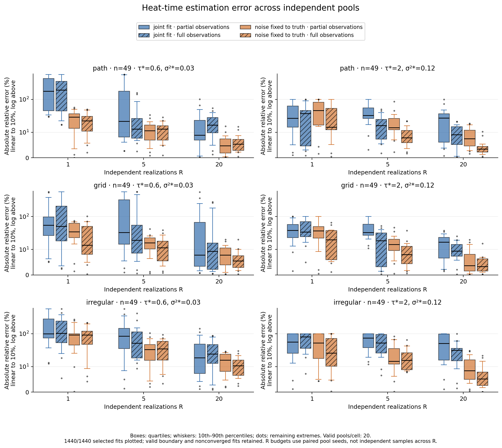
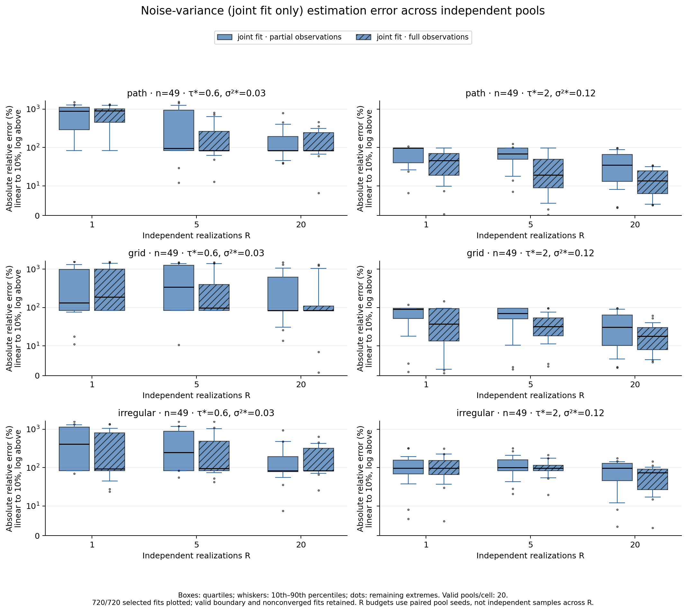
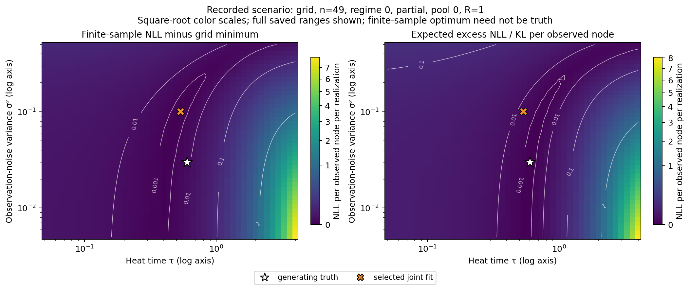
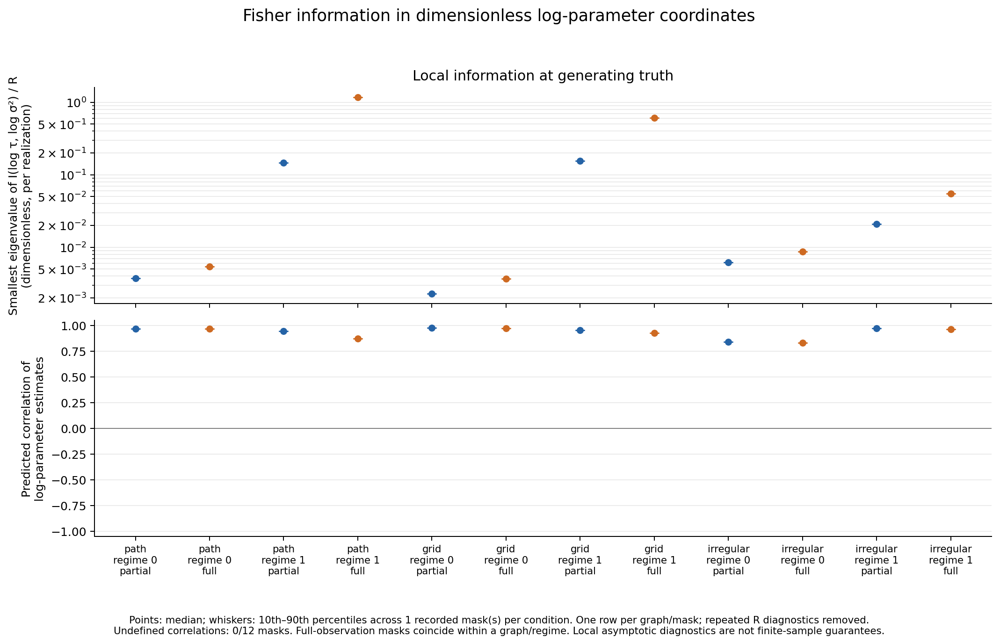
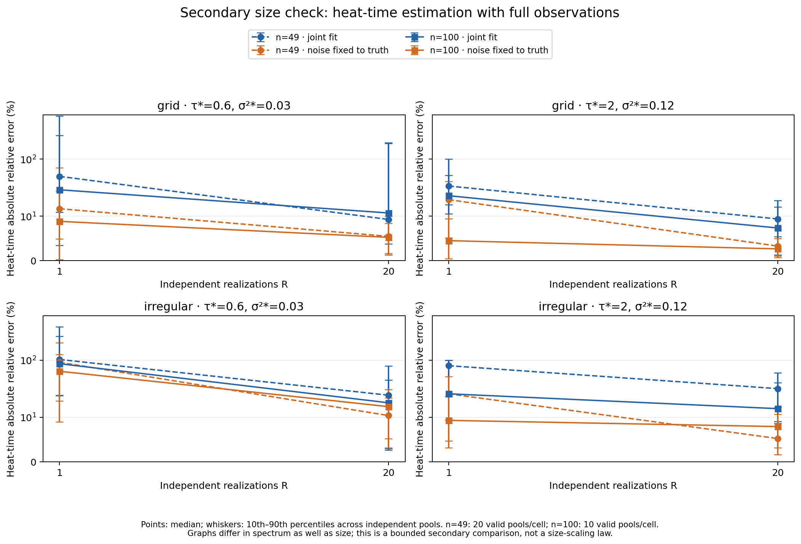

# Stage 02: heat-kernel identifiability with independent realizations

The tested covariance family is locally identifiable at the generating
parameters, but useful finite-data precision depends strongly on the graph,
observation mask and noise knowledge. More independent function draws substantially
improve heat-time estimates in many conditions. Joint noise estimation remains
weak at low noise even with 20 draws. Numerical equivalence with GPyTorch does not
imply statistical hyperparameter recovery.

## Model, sampling units and method

We fix zero mean, unit amplitude and `L = L_combinatorial / max_degree`, retaining
the Stage 01 semantics. The observed covariance is
`C(tau, noise) = [exp(-tau L)]_OO + noise_variance I`: selection occurs **after**
the full-graph matrix exponential. Each new realization draws a fresh latent
function and fresh Gaussian noise with standard deviation `sqrt(noise_variance)`.

The exact dense statistical oracle caches one eigendecomposition per graph and
uses Cholesky solves, analytic gradients, expected excess NLL/KL and Fisher
information in log-parameter coordinates. Its pooled NLL is normalized per
observed node and realization. Bounded L-BFGS-B optimizes log parameters from
two fixed initializations `(0.3,0.04)` and `(2.8,0.2)`, independent of truth.
The physical bounds remain tau=[0.05,4], noise variance=[0.005,0.5]; the dense
reference permits endpoints, which the production Interval transform approaches
from the interior. No inverse or hidden jitter is used. The production engine
remains GPyTorch ExactGP and the sparse Chebyshev operator.

Primary: path, grid and fixed-seed Barabási–Albert graphs, n=49; truths
`(0.6,0.03)` and `(2,0.12)`; partial observations (36 or 24 nodes) and full
observations; R=1/5/20; joint estimation and a **noise-known oracle control**.
Topology seed is 2718. Separate SeedSequence streams generate masks, latent
functions and noise. A fixed mask per graph/regime is shared across all 20 pool
seeds (0–19). Partial/full designs share each pool's full arrays; R budgets use
nested prefixes. The noise-known control fixes noise at its generating value.

There are **120 independent full-draw pools**, 240 paired mask conditions,
**1,440 selected fits and 2,880 optimizer starts**. Starts, masks, R budgets and
fit modes are not additional independent sampling units. Each summary cell
contains exactly 20 pools. A separate n=100 grid/irregular check uses full
observations, R=1/20 and 10 pools: **40 pools, 160 fits and 320 starts**.
All scientific fits and arrays completed; no invalid start or Cholesky failure
occurred. [Configuration](evidence/identifiability/config.json),
[counts](evidence/identifiability/completion.json) and
[schema/evidence guide](evidence/identifiability/README.md) document the design.

## Numerical gates

The complete suite runs **70 tests: 69 pass and one CUDA test is skipped**.
Fourteen new mathematical tests cover likelihood normalization, finite-difference
and Torch-autograd gradients, replicate pooling, KL positivity without clipping,
Fisher scaling/curvature, mask semantics, independent sampling/prefixes,
known noise, boundary solutions, nonconvergence and explicit factorization
failures. Three summary tests verify independent-pool and failure accounting;
one regression verifies explicit training mode. Both experiment smoke commands
pass; CI includes them and the full suite.

At three non-optimum parameter pairs, the direct likelihood agrees with the
previous exact oracle and GPyTorch A within **4.45e-16**. Sparse C differs by at
most **2.00e-10** using controlled exhaustive trace probes. A GPyTorch Python-scalar
noise setter first rounds through the default float32 dtype; parity checks
explicitly assign a float64 tensor and record the effective stored parameters.
This is a validation setup correction; historical results and the production
factory were preserved. [Measured parity](evidence/identifiability/validation.json).

## Primary results

The table shows **median absolute relative errors**, with 10th–90th percentiles,
for full observations and R=20. Each row is 20 independent pools. All valid
boundary and nonconverged selections remain included. No statistical recovery
threshold was chosen after seeing the data.

| Graph | True tau / noise variance | Heat-time error, median [p10,p90] | Noise error, median [p10,p90] | Near-boundary fits |
|---|---|---|---|---|
| Path | 0.6 / 0.03 | 16.5% [4.7,40.0] | 83.3% [65.8,316.6] | 8/20 |
| Grid | 0.6 / 0.03 | 9.3% [1.3,188.5] | 83.3% [75.8,1070.7] | 13/20 |
| Irregular | 0.6 / 0.03 | 24.3% [2.6,79.2] | 83.3% [69.9,429.5] | 8/20 |
| Path | 2 / 0.12 | 9.1% [0.6,17.2] | 13.6% [3.8,31.7] | 0/20 |
| Grid | 2 / 0.12 | 9.4% [5.4,19.0] | 17.9% [5.4,41.2] | 0/20 |
| Irregular | 2 / 0.12 | 31.7% [8.6,60.1] | 73.3% [16.9,103.6] | 3/20 |

The low-noise grid median hides a long upper tail. Noise hits its lower bound
frequently: an estimate of 0.005 instead of 0.03 already gives 83.3% relative
error. Every primary graph/mask has median noise error 83.3% in that regime at
R=20. Across the six graph/regime strata, equally weighted, the partial-observation
joint heat median falls from **59.3% at R=1 to 16.6% at R=20**; with full
observations it falls from **54.7% to 13.5%**. This aggregate describes this fixed
design and does not replace the per-stratum distributions.

Fixing noise helps: corresponding R=20 medians are **7.2% partial and 5.3% full**.
Across individual graph/regime/mask cells, known-noise heat medians range
**3.3–15.7%**, with no R=20 boundary fits. This oracle control demonstrates the
effect of heat/noise confounding; it assumes knowledge that ordinary training
does not have. Paired R=1→20 heat-error improvement occurs in 50–100% of pools
per joint-fit cell and 80–95% per known-noise cell, not every pool.

An important difficult condition remains: irregular graph, tau=2, partial
observations, R=20 has **51.0% heat error and 95.8% noise error**, with 8/20
boundary flags. [All per-cell summaries](evidence/identifiability/summary.csv) and
[paired comparisons](evidence/identifiability/paired_comparisons.csv) retain the
complete distributions and counts.





## Expected likelihood and information

The likelihood figure uses the preregistered grid/n49/low-noise/partial/pool0/R1
scenario. The population KL is zero at truth; its shallow valley differs from
the individual sample's likelihood. True parameters need not minimize a given
sample NLL.



All 12 primary graph/regime/mask Fisher matrices are numerically nonsingular
at truth, supporting **local** identifiability. Practical information can still
be small. Low-noise path/grid log-parameter estimate correlations are
**0.966–0.975**, with per-realization smallest information eigenvalues
**0.00229–0.00539**. At tau=2 with full observations, the smallest eigenvalue is
**1.177** for path and **0.606** for grid, versus **0.0550** for irregular; the
irregular partial value is **0.0208**, with correlation **0.972**. These contrasts
are consistent with the observed joint-estimation difficulty. Condition number
alone cannot rank precision: both absolute information and parameter directions
matter. Total information scales exactly linearly with R; the plot divides by R.
These are local asymptotic diagnostics, not finite-sample confidence guarantees.



## Optimization and secondary checks

Primary outcomes retain **318 near-boundary selections, 83 start-disagreement
flags, two nonstationary selections and one SciPy abnormal termination**. The
abnormal termination already has a projected-gradient norm of 1.16e-9, below the
separate 1e-6 stationarity threshold. Optimizer success and stationarity are
therefore reported separately. A valid nonconverged fit can be selected by its
actual exact NLL. Best-of-two selection is not a global optimum certificate.

A bounded follow-up targets the **84 flagged conditions** using only recorded
optimizer/start diagnostics, never recovery error. A fixed 9×9 grid supplies two
separated starts plus a restart at the original selected estimate: **252 extra
starts, zero new pools**. Only three cases improve NLL by more than 1e-7 per
observation; maximum improvement is 0.0018004. The two nonstationary fits move to
tau=4 stationary boundary solutions, and one path fit reaches a lower local
minimum. All audit selections meet the projected-gradient criterion; the same
one SciPy abnormal flag remains, and **21/84 still have start disagreement**.
Original study files, tables and distributions are preserved. The
[audit evidence](evidence/identifiability/optimizer_audit/completion.json) makes
this residual optimization uncertainty explicit.

All 160 secondary selections are valid and stationary; 22 have boundary flags
and six start-disagreement flags. For full-observation grid/tau=2/R20, n=100
heat/noise medians are **7.4%/7.0%**; irregular gives **14.1%/34.9%**. Low-noise
noise-error medians remain **115.1% grid and 113.0% irregular**. More vertices
do not uniformly resolve weak identification: graph spectra, degree rescaling,
and sampled fields differ. This bounded comparison is not a size-scaling law.



## Reproduction and next stage

Measured on 2026-10-23, CPU float64, one Torch/BLAS thread: Python 3.12.0,
Torch 2.11.0, GPyTorch 1.15.2, linear_operator 0.6.1, NumPy 2.4.3,
SciPy 1.17.1, NetworkX 3.6.1, Matplotlib 3.10.8.
[Environment](evidence/identifiability/environment.json). The primary/secondary
data-producing source is commit `d57b30a`; the audit records its own source/hash.
The audit's dirty flag reflects five untracked generated figures; its driver
hash matches the unchanged tracked source at `fe2ea24`.
Generated arrays remain under ignored `results/`; complete small CSV/JSON tables
and five report figures are committed. Existing evidence and provenance hashes
were preserved. The README now reflects the repository's public visibility;
redistribution terms remain unspecified.

```bash
python3 -m venv .venv
source .venv/bin/activate
python -m pip install -e . -c requirements-tested.txt
python -m unittest discover -s tests -v
python experiments/02_heat_identifiability.py --smoke
python experiments/02_heat_identifiability.py
python experiments/02_heat_identifiability.py --secondary
python experiments/02_audit_identifiability.py
python experiments/02_plot_identifiability.py \
  --input docs/evidence/identifiability \
  --secondary-input docs/evidence/identifiability/secondary --output docs/figures
```

Use a fresh output directory when rerunning a study; the driver preserves
existing results. The evidence guide documents exact row units and columns.
Twenty pools establish descriptive differences, not universal consistency or
uniformly reliable recovery. The next research step should be a separate minimal
graph×time GP, carrying these identifiability controls forward, rather than
indefinite heat-only tuning. Mixtures, graph×time kernels and new solvers were
outside this stage.
