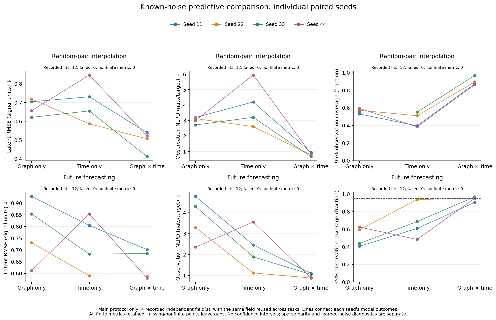
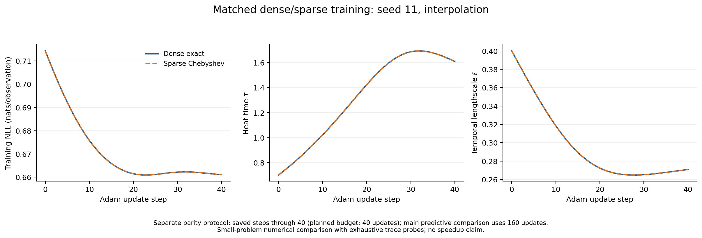
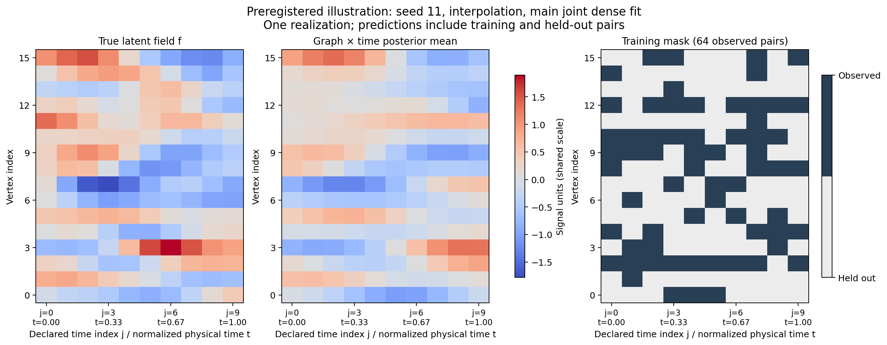

# Stage 03: a finite-grid graph × time Gaussian process

## 1. Question and model

Can the existing differentiable sparse heat operator support a separable
graph × time GP through GPyTorch training and prediction, with independently
checked numerical accuracy? Does using both coordinates help in a small
synthetic interpolation and forecasting study?

The actual starting main commit was
`19b022fd9cadad3026534b4c98f4134d8b3c5d64` (merged Stage 02). Its complete
baseline suite passed: 69 tests passed and one CUDA test skipped. The full
Stage 03 study used clean computational source
`6d1f850964098fd98f353739f3be46618d85071a`; the
[environment record](evidence/graph_time/compile_environment.json) includes
source hashes. Later commits add measured evidence and this report.

The prior has zero mean, fixed unit amplitude and covariance

\[
K_G=e^{-\tau L},\qquad
(K_T)_{ij}=\exp[-(t_i-t_j)^2/(2\ell^2)],\qquad
t_j=j/(T-1),\quad T\ge2.
\]

The Laplacian remains the combinatorial Laplacian divided by maximum degree,
with spectrum enclosed by `[0,2]`. Heat-time units therefore match Stages 01/02.
The full covariance is `KG ⊗ KT` in vertex-major/time-minor order `v*T+j`.
For row-major `X` of shape `(n,T)`, its action is `KG @ X @ KT.T`.
Arbitrary pair selection gives `S(KG ⊗ KT)S.T + noise_variance*I`.
Noise is independent per recorded observation, including repeated pairs.
There is no latent nugget or learned amplitude.

Public inputs are nonempty, unbatched CPU float64 `(m,2)` tensors of exactly
integer-valued `(vertex_id,time_index)` coordinates. Invalid shape, dtype,
device, finite/integer/range checks fail explicitly. The declared time grid is
fixed at construction: forecasts use their original physical times rather
than rescaling to the observed subset. This API does not accept arbitrary
continuous times or extend its time grid after construction.

## 2. Implementation

`GraphHeatKernel.full_graph_operator()` now exposes the existing differentiable
Chebyshev operator using the same CSR graph, nodes, cached cosine basis and
coefficients. Its old selected-node forward path calls this helper. The new
`GraphTimeHeatRBFKernel` combines that graph factor with a dense, differentiable
`T×T` GPyTorch RBF factor using the installed
`KroneckerProductLinearOperator`. One interpolation index `v*T+j` per input
handles missing, unordered, repeated and unequal left/right pair lists.
The library operator passed the required action, autograd and GP integration
tests; no custom Kronecker fallback or custom solver was necessary.

`make_graph_time_gp` reuses `GraphGP` (`ExactGP`), `GaussianLikelihood`,
`ExactMarginalLogLikelihood` and `predict_marginals`. Its dense exact backend
uses the existing graph eigensystem as a small reference; the sparse backend
uses only the Chebyshev graph operator. Heat time, temporal lengthscale and
noise variance have bounds `(0.05,4)`, `(0.08,0.8)` and `(0.005,0.5)`.
Defaults are `0.7`, `0.4`, `0.06`; `learn_noise=False` freezes raw noise.
There are exactly two trainable scalar degrees of freedom by default.

The narrow factory fix initializes noise and graph-only amplitude directly
from float64 tensors. A regression using non-float32-representable scalar
values failed before this fix and passed afterward at absolute tolerance
`1e-14`. Only Laplacian input validation was extracted for reuse; prior stage
test tolerances and evidence remain unchanged. No dependencies were added.

The independent NumPy/SciPy oracle uses `expm`, an explicit RBF formula,
`np.kron`, and Cholesky solves, without production kernel imports, matrix
inversion or adaptive jitter. Pair-selection oracle functions take explicit
`num_times`: a plain full covariance array does not uniquely identify its
graph/time factor dimensions.

Sparse MVPs avoid forming a dense graph factor or full prior on the exercised
paths, but retain full `nT` workspace and a dense `T×T` factor. Exact target
marginal variance work is retained. This milestone does not supply compressed
time factors, approximate marginal variances or large-scale performance data.

## 3. Numerical validation

All 93 tests ran successfully apart from the expected CUDA skip (92 passed).
This includes the unchanged graph-only and Stage 02 statistical suites. The
[retained validation measurements](evidence/graph_time/validation.json) were
recomputed before any main fit.

The kernel sweep covers path/grid graphs, `n=9,16`, `T=4,7`, heat times
`0.7,2.2` and lengthscales `0.24,0.56` (32 configurations, degree 32).
It uses nonseparable random RHS matrices of width 1 and 3. Maximum absolute
errors were:

| Comparison | Maximum absolute error |
|---|---:|
| Dense full prior versus independent oracle | 2.165e-15 |
| Sparse MVP versus independent oracle | 2.209e-14 |
| Sparse selected entries versus independent oracle | 2.082e-15 |
| Sparse MVP versus explicit `KG X KT.T` action | 2.198e-14 |

Tests also cover vector RHS, covariance diagonal/cross-selection, PSD,
repeated observations and targets, unseen forecast positions, invalid inputs,
fresh-model state round trips, both kernel derivatives against independent
dense Torch autograd and centered finite differences, and direct full-graph
operator action/derivatives. No gradients are detached from the graph or
temporal parameters.

Two deterministic GP cases use `n=9`, `T=5`, 18 recorded training observations
and eight targets, including repeated pairs and future indices. Their
`(tau,ell,noise_variance)` are `(0.93,0.29,0.073456789123)` and
`(1.73,0.43,0.16)`. Dense inference forces direct Cholesky. Sparse inference
disables Cholesky, eager conversion and preconditioning, requests CG tolerance
`1e-8`, permits 500 CG iterations, and uses a complete orthonormal trace basis
with up to 18 requested Lanczos iterations. Maximum measured errors:

| Gate | Dense exact | Sparse Chebyshev | Required bound |
|---|---:|---:|---|
| NLL per observation | 4.219e-15 relative | 2.007e-10 absolute | dense relative 1e-9; sparse absolute 1e-5 |
| Physical gradients, all three parameters | 4.441e-15 absolute | 1.036e-5 absolute | elementwise rtol 2e-4, atol 2e-6 |
| Raw gradients | 1.776e-15 absolute | 1.864e-6 absolute | same elementwise gradient tolerance |
| Posterior mean | 1.566e-14 | 5.578e-6 | dense 1e-8; sparse 2e-4 absolute |
| Latent marginal variance | 2.970e-15 | 1.050e-10 | same posterior bounds |
| Observation marginal variance | 2.998e-15 | 1.050e-10 | same posterior bounds |

The sparse physical-gradient maximum exceeds the absolute term alone but
passes the specified combined relative/absolute criterion at every tested
parameter. Mean-only versus variance-route means matched exactly in these
cases; chunking differences were at most `1.943e-16`.

Each small sparse case made eight actual CG calls and one actual SLQ call.
The MLL forward used 501 graph-operator matmuls, backward used three, and the
combined full/chunked/mean-only prediction checks used 3,535. Actual SLQ
tridiagonal order was 15, despite requesting 18; no claim of 18 completed
Lanczos steps is made. Recorded CG residual warnings ranged from `4.957e-6`
to `7.383e-6` after 500 iterations, above the requested `1e-8`. The pinned
solver's denominator cutoff `eps=1e-10` is consistent with this residual
floor. Installed defaults were preserved. The measured NLL, gradient and
posterior gates passed despite the warnings; requested tolerance is not
reported as achieved tolerance.

Runtime guards reject actual Chebyshev graph `.to_dense`, full Kronecker
`.to_dense`, `torch.kron`, direct Cholesky and unbatched dense graph
eigendecomposition on sparse validation paths. Dense temporal factors,
selected cross blocks and batched Lanczos eigensystems are allowed. These
guards cover the exercised CPU paths, not every conceivable allocation.
Sampling tests separately check a tiny 1,200-draw covariance against a
Gaussian sampling-error tolerance and verify the exact RNG stream invariant.

## 4. Study design

The fixed synthetic study uses a 4×4 grid, ten declared times in `[0,1]`,
true heat time `1.2`, lengthscale `0.24`, noise variance `0.06`, zero mean
and unit amplitude. Seeds `11,22,33,44` each produce one latent field and one
independent observation-noise field. Separate predetermined mask streams
select training positions. The two tasks share each seed's complete fields:
there are four independent realizations, not eight independent problems.

Interpolation trains on 64 of 160 pairs and tests the remaining 96.
Forecasting trains on 48 of the 96 historical pairs with `j<6`; all 64 pairs
at `j=6,7,8,9` are test targets. Historical pairs not selected for training
are not forecast test targets. Tests verify no train/test overlap, no future
training pair, shared full fields and independently generated split masks.

Three unit-amplitude models run on every seed/task: graph-only ignores time,
time-only ignores vertex, and joint uses both. Graph-only uses the existing
degree-32 sparse heat covariance with direct selected-covariance Cholesky;
time-only and main joint use direct inference, with joint graph covariance
dense exact. All 24 main fits freeze noise at `0.06`, start present parameters
at `tau=0.7`, `ell=0.4`, and perform 160 Adam updates at learning rate `0.05`.
There is no outcome-based retry or initialization search.

Separately, seeds 11/22 on both tasks have matched dense/sparse joint fits
with exactly 40 Adam updates (eight fits). Sparse settings request `1e-7`
CG tolerance and up to `n_train` Lanczos iterations, use exhaustive probes
and disable Cholesky/preconditioning. This deliberately expensive parity
protocol is excluded from the main model ranking. Two secondary dense joint
fits, seed 11 on each task, learn noise from initial variance `0.12` for
160 updates. They too are excluded from the main ranking.

Metrics score posterior means against the latent field for latent RMSE and
against noisy held-out observations for observation RMSE. Observation NLPD
and 95% marginal coverage use **latent variance plus noise variance**.
No negative or nonfinite variance is clipped. Each fitted endpoint is also
checked using independent exact conditioning and normalized train NLL.
Loss/gradient evaluation after the final update records convergence diagnostics
without an additional optimizer update.

## 5. Results

All 34 fits completed their prescribed updates, with no failures or negative/
nonfinite target variances. Four sparse parity fits have status
`ok_with_numerical_warnings`; the other 30 have status `ok`. Every fit and
score is retained in [fits.csv](evidence/graph_time/fits.csv) and
[metrics.csv](evidence/graph_time/metrics.csv).

The following seed-level main results are rounded to four decimals. Coverage
is a fraction; NLPD is per held-out noisy observation.

| Task | Seed | Model | Latent RMSE | Observation RMSE | Observation NLPD | 95% coverage |
|---|---:|---|---:|---:|---:|---:|
| Interpolation | 11 | Graph | 0.7044 | 0.7529 | 3.2016 | 0.5312 |
| Interpolation | 11 | Time | 0.7311 | 0.7738 | 4.2083 | 0.3958 |
| Interpolation | 11 | Joint | 0.5398 | 0.6121 | 0.9409 | 0.8750 |
| Interpolation | 22 | Graph | 0.7188 | 0.7446 | 3.1305 | 0.5729 |
| Interpolation | 22 | Time | 0.5868 | 0.6320 | 2.6122 | 0.5104 |
| Interpolation | 22 | Joint | 0.5068 | 0.5464 | 0.7893 | 0.8958 |
| Interpolation | 33 | Graph | 0.6213 | 0.6872 | 2.7193 | 0.5521 |
| Interpolation | 33 | Time | 0.6557 | 0.6982 | 3.2131 | 0.5521 |
| Interpolation | 33 | Joint | 0.4120 | 0.4887 | 0.6715 | 0.9688 |
| Interpolation | 44 | Graph | 0.6569 | 0.7182 | 3.0025 | 0.5938 |
| Interpolation | 44 | Time | 0.8472 | 0.8993 | 5.9518 | 0.3854 |
| Interpolation | 44 | Joint | 0.5225 | 0.5969 | 0.8529 | 0.8646 |
| Forecast | 11 | Graph | 0.9284 | 0.9427 | 4.7790 | 0.4062 |
| Forecast | 11 | Time | 0.8047 | 0.8403 | 2.4610 | 0.6094 |
| Forecast | 11 | Joint | 0.7018 | 0.7419 | 1.1013 | 0.9062 |
| Forecast | 22 | Graph | 0.7313 | 0.7824 | 3.2909 | 0.5938 |
| Forecast | 22 | Time | 0.5902 | 0.6471 | 1.1232 | 0.9375 |
| Forecast | 22 | Joint | 0.5896 | 0.6475 | 0.8825 | 0.9531 |
| Forecast | 33 | Graph | 0.8536 | 0.8757 | 4.2983 | 0.4375 |
| Forecast | 33 | Time | 0.6828 | 0.7207 | 1.8930 | 0.6875 |
| Forecast | 33 | Joint | 0.6852 | 0.7038 | 1.0518 | 0.9688 |
| Forecast | 44 | Graph | 0.6123 | 0.6515 | 2.3557 | 0.6250 |
| Forecast | 44 | Time | 0.8534 | 0.8889 | 3.5582 | 0.4844 |
| Forecast | 44 | Joint | 0.5811 | 0.6312 | 0.9010 | 0.9531 |

Across exactly four seeds, medians [minimum, maximum] are:

| Task | Model | Latent RMSE | Observation NLPD | 95% coverage |
|---|---|---|---|---|
| Interpolation | Graph | 0.6806 [0.6213,0.7188] | 3.0665 [2.7193,3.2016] | 0.5625 [0.5312,0.5938] |
| Interpolation | Time | 0.6934 [0.5868,0.8472] | 3.7107 [2.6122,5.9518] | 0.4531 [0.3854,0.5521] |
| Interpolation | Joint | 0.5147 [0.4120,0.5398] | 0.8211 [0.6715,0.9409] | 0.8854 [0.8646,0.9688] |
| Forecast | Graph | 0.7925 [0.6123,0.9284] | 3.7946 [2.3557,4.7790] | 0.5156 [0.4062,0.6250] |
| Forecast | Time | 0.7437 [0.5902,0.8534] | 2.1770 [1.1232,3.5582] | 0.6484 [0.4844,0.9375] |
| Forecast | Joint | 0.6374 [0.5811,0.7018] | 0.9764 [0.8825,1.1013] | 0.9531 [0.9062,0.9688] |

Observation RMSE medians are respectively `0.7314,0.7360,0.5716` for
interpolation and `0.8291,0.7805,0.6757` for forecasting (Graph, Time, Joint).
Observation RMSE medians and ranges are also in
[summary.csv](evidence/graph_time/summary.csv); individual values are in
[metrics.csv](evidence/graph_time/metrics.csv). No confidence intervals are
inferred from four realizations. Pairing and unfavorable cases remain visible:

Joint interpolation fitted heat times range `0.7988–1.5266` and lengthscales
`0.1996–0.3415`; forecast ranges are `1.1694–1.5143` and `0.2081–0.2562`.
These are fitted likelihood parameters, not recovery guarantees. No endpoint
is flagged within 1% of an interval boundary. Time-only seed 44 lengthscales
(`0.7614` interpolation, `0.7734` forecast) are relatively near the upper
bound even though outside that flag criterion. All main final NLLs are below
their first values. Main final raw-gradient norms range from `5.264e-7` to
`1.159e-3`; this finite budget is not proof of global convergence. Joint main
final NLL ranges are `0.6607–0.8224` for interpolation and `0.7169–0.9080`
for forecasting. Full first/final values remain in `fits.csv`.

In the four matched 40-update datasets, maximum dense/sparse disparities are:

| Quantity | Maximum absolute difference |
|---|---:|
| Own training NLL trajectory, all steps | 1.308e-7 |
| Endpoint heat time | 2.096e-6 |
| Endpoint lengthscale | 2.169e-6 |
| Independent exact endpoint train NLL | 4.051e-8 |
| Endpoint predictive mean, fitted dense versus fitted sparse | 1.093e-5 |
| Endpoint latent/observation variances, fitted dense versus fitted sparse | 2.435e-6 |
| Sparse fixed-endpoint mean versus independent conditioning | 8.516e-6 |
| Sparse fixed-endpoint latent/observation variance versus independent conditioning | 5.651e-7 |

Every sparse parity fit used 20,664 training graph-operator matmuls (661,248
degree-32 recurrence Laplacian applications with multiple RHS columns),
41 SLQ calls and 44–45 total CG calls including prediction. Actual SLQ orders
ranged `28–37` for requested 48/64, and 178 CG warnings across the four fits
reported residuals `6.105e-6–7.984e-6`. These warnings are retained. Training
took `18.89–22.95` seconds per sparse parity fit on the recorded one-thread
CPU configuration; exact held-out marginal/mean-only prediction routes took
`0.93–1.35` seconds combined. Exhaustive probes and stringent tolerances make
this an accuracy audit, not an optimized runtime comparison or speedup claim.
Final parity raw-gradient norms `0.0041–0.0134` further show why its 40-step
results should not be pooled with the 160-step main study.

Across all 34 fits, mean-only versus marginal-route means differed by at most
`2.132e-14`; minimum held-out latent variance was `0.001980` and minimum
observation variance was `0.061980`. Direct-inference fits' maximum
independent endpoint mean error was `2.842e-14` and variance error `1.721e-15`.

The two learned-noise diagnostics produced:

| Seed 11 task | Fitted tau | Fitted ell | Fitted noise variance | Latent RMSE | Observation NLPD | Coverage |
|---|---:|---:|---:|---:|---:|---:|
| Interpolation | 1.4657 | 0.2688 | 0.04215 | 0.5371 | 0.9753 | 0.8333 |
| Forecast | 1.3251 | 0.2249 | 0.02353 | 0.6848 | 1.0846 | 0.9062 |

Both noise estimates are below the generating `0.06`. Interpolation slightly
improves RMSE but worsens observation NLPD and coverage versus its fixed-noise
joint fit; forecast RMSE and NLPD improve modestly. These two correlated
diagnostics do not establish general noise recoverability.

The illustrative signal below was fixed in advance as seed 11 interpolation,
main joint dense fit. Its observed-mask panel is explicit. Predictions use the
full declared grid; the mask is independent of model outcomes.

## 6. Interpretation and limitations

The sparse graph × time covariance is differentiable through actual
GPyTorch CG/SLQ training and exact marginal prediction on these small
problems, and agrees with an independent dense reference within all prescribed
numerical gates. The solver warnings remain a real limitation; excellent
covariance approximation does not imply that a requested iterative residual
tolerance was reached.

Joint modeling lowers both RMSE measures and observation NLPD versus both
baselines on every interpolation seed. Forecasting has higher joint median
RMSE and NLPD than interpolation, consistent with less temporal support
beyond the last historical training time. It improves forecast NLPD versus
both baselines on every seed, but latent RMSE on seed 33 is slightly worse
than time-only (`0.685201` versus `0.682772`), and observation RMSE on seed 22
is slightly worse (`0.647544` versus `0.647081`). Joint coverage is closer to
the nominal level overall, yet interpolation median coverage is only `0.8854`.
Neither these dependent marginals nor four realizations demonstrate guaranteed
calibration. Baselines intentionally omit a true covariance dimension, so this
study measures that restricted comparison, not superiority over richer models.

Stage 02's finite-data identifiability caution still applies. Fixed amplitude
and known noise control important confounding, but fitted tau/ell vary with
field and mask, single starts do not prove global likelihood optima, and two
learned-noise diagnostics are too few for a recovery claim. This stage tests
one correctly specified separable family on one graph and fixed time grid.

Irregular observation selection still expands MVP work into the full `nT`
grid. Temporal storage is quadratic in `T`; exhaustive probe storage is
quadratic in the number of training observations. Exact requested marginal
variances can require substantial additional solves and selected-column work.
The small guard instrumentation, fixed degree and single CPU environment
provide no broad scaling evidence. No temporal compression or adaptive
variance estimator was introduced.

All three figures regenerate from the compact committed CSV package without
training or sampling, with identical image hashes in the recorded environment.
The [evidence README](evidence/graph_time/README.md) documents schemas, units,
commands, warning-path normalization and raw-output boundaries.

## 7. Next step

Prioritize spatiotemporal operator scalability under irregular observations.
Measure graph RHS widths, full-grid work and exact variance costs as `n`, `T`
and observation density change, starting from this verified separable model.
The 20,664 training graph matmuls per small sparse parity fit, repeated
500-iteration residual warnings and expensive exact variance routes make this
the immediate bottleneck to investigate. Any subsequent solver-setting or
compression change should be separately justified against the same independent
oracle; it is not part of Stage 03. Kernel composition is deferred.
