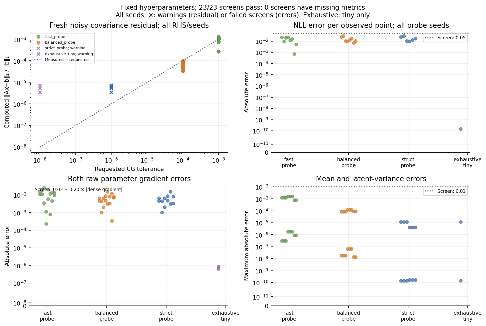
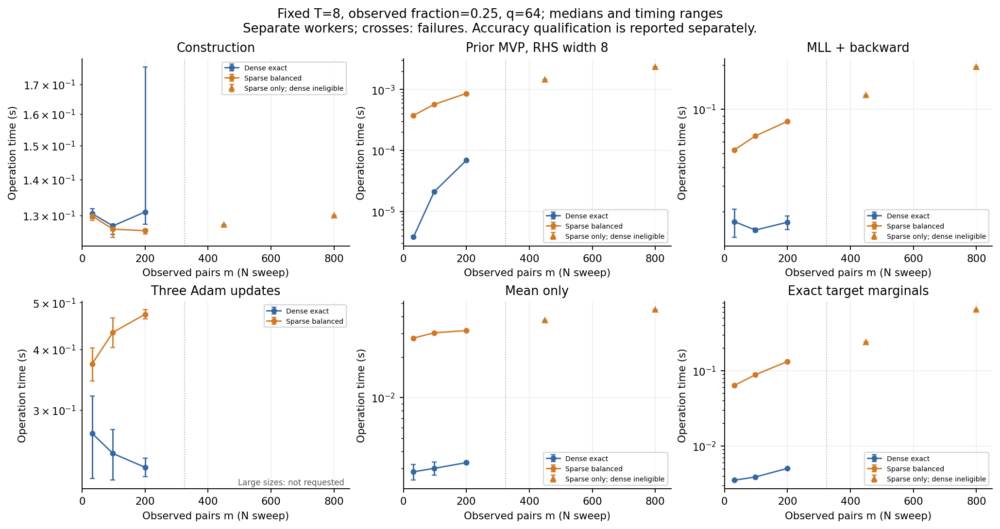
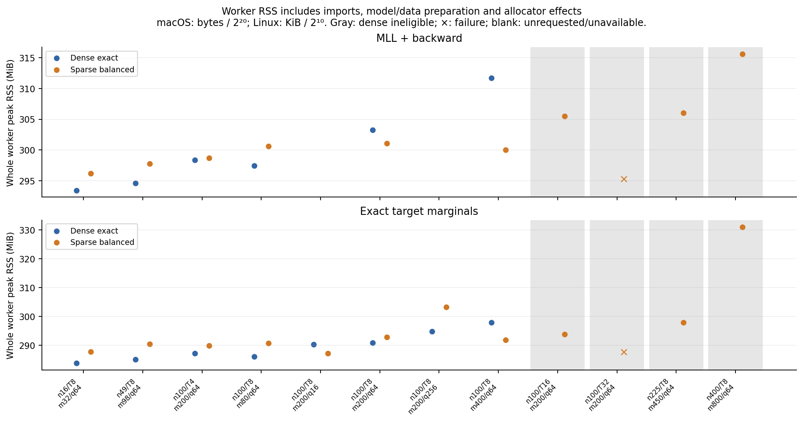
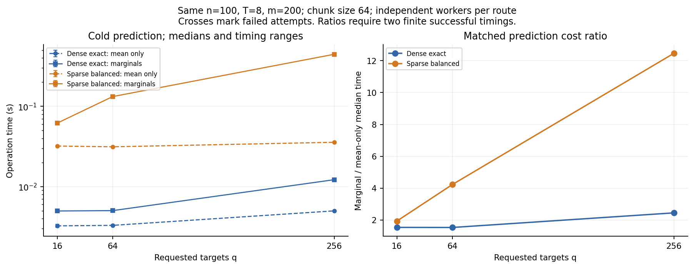

# Stage 04: graph-time GP costs and solver diagnostics

## 1. Research questions and benchmark setup

This stage measures where the current matrix-free graph-time GP spends time
and resident memory, whether its stochastic inference is accurate enough for
the declared benchmark, and whether any matched performance crossover occurs.
It does not tune hyperparameters or introduce a new inference algorithm.
The measured result is an accuracy-qualified memory tradeoff in some small
configurations, with **no GP elapsed-time crossover**. Current sparse inference
and exact marginal prediction remain slower than dense exact in the matched
range; less worker memory does not imply faster inference.

The actual starting main was `4f90ba5d64f7fe08f9f89697f3be06ce508c450a`.
Its baseline had 92 passing tests, one CUDA skip, and three successful historical
smokes. Final measurements use clean source
`060a3089cbfb008ca2c8775e35cb9503f967110c`; source hashes, initial import
relationships and hardware/software records are retained in the
[evidence package](evidence/scaling_stage04/README.md).

All cases use square grids, the unchanged degree-scaled combinatorial Laplacian,
CPU float64, one Torch/BLAS thread, unit amplitude, zero mean, heat time 1.2,
RBF lengthscale 0.24 and observation noise **variance** 0.06. Coordinates are
integer-valued vertex/time-index pairs; physical time remains `j/(T-1)` and
flattening remains `v*T+j`. The signal is the controlled approximate field
`P32(exp(-tau L/2)) Z chol(KT).T` plus independent noise, not an independent
exact-GP sample or parameter-recovery experiment. Separate SeedSequence streams
use master 202604 and explicit case IDs. Nested density masks and disjoint fixed
target prefixes are shared by backends; probe seed labels 301/302/303 map to
separately recorded effective Torch seeds.

There are 12 unique configurations: graph sizes 16/49/100/225/400 at T=8 and
25% observations; T=4/8/16/32 at n=100,m=200; m=80/200/400 at n=100,T=8;
and q=16/64/256 at n=100,T=8,m=200. Default q is 64. Eight configurations
meet the dense ceiling n≤100,nT≤800,m≤400,q≤256. Dense and sparse operations
use the same joint GP and data. The full command attempts 368 separate workers:
95 solver checks and 273 scaling measurements, with a hard 180-second worker
wall limit. Cheap small operations have three independent timing repeats;
small GP operations have two; n≥225 and T=32 have one bounded attempt.
MVPs alone warm up once before five timed products. There is no GP warmup or
shared prediction cache. Three-update fits make exactly three Adam updates
at 0.05 and four loss/gradient evaluations, not a convergence study.

The machine is an Apple M4 with ten reported physical/logical cores, macOS
26.6.2 arm64, Python 3.12.0, Torch 2.11.0, GPyTorch 1.15.2,
linear_operator 0.6.1, NumPy 2.4.3 and SciPy 1.17.1. Worker elapsed operation
time, import time, data setup, model setup and parent subprocess wall time
are distinct. RSS is the entire isolated process peak, including imports and
allocators; macOS bytes are converted to MiB. No peak subtraction or tracemalloc
claim is made, and no host memory ceiling was imposed.

## 2. Small-case fidelity and stochastic-probe accuracy

The unchanged Stage 03 deterministic covariance, gradient, MLL and posterior
gates remain hard correctness tests. Independent Stage 04 references use the
Stage 03 SciPy/NumPy oracle and a separate Torch expression for raw gradients.
Only explicitly labeled small dense/reference workers form dense graph/full-grid
covariances. Sparse guards cover the exercised construction and inference paths;
they permit dense temporal factors, selected blocks and Lanczos tridiagonals.

Across all eight dense-eligible primary cases, polynomial MVP maximum absolute
error is 1.843e-14. Dense NLL error is at most 2.221e-16 and posterior mean
error 2.831e-15. Primary balanced sparse maxima are 0.02376 for normalized
NLL, 0.01400/0.01116 for raw heat/lengthscale gradients, 1.542e-4 for mean and
7.620e-8 for latent variance. All 184 operation-level case checks pass their
applicable screening bounds; they remain separate from the 23 full profile/seed
screens in the 207-row accuracy table.

All 23 profile/seed controls passed the predeclared operational screens. Each
stochastic profile passed all six required n16/n49 checks (three seeds each);
n100 has two additional seeds for fast and balanced, and tiny exhaustive has
one parity control. These screens permit NLL error 0.05 per observation,
raw-gradient error `0.02+0.20*abs(exact)`, mean/latent-variance error 0.01 and
true solve residual 0.01 for fast or 0.001 for balanced/strict. They are
benchmark screening rules, not precision or calibration guarantees.
Each profile's posterior screen uses the same predetermined 32 target pairs.

| Profile | Maximum NLL error | Maximum mean error | Maximum latent-variance error |
|---|---:|---:|---:|
| Fast, 8 probes / 16 Lanczos max | 0.02281 | 0.001641 | 1.817e-6 |
| Balanced, 16 / 32 | 0.03049 | 1.217e-4 | 6.440e-8 |
| Strict, 16 / 32 | 0.03049 | 1.158e-5 | 1.711e-10 |
| Exhaustive tiny, 32 / 32 | 1.501e-10 | 1.158e-5 | 1.451e-10 |

For n16, exact normalized NLL is 1.174040602. The fast three-seed NLL
range is 1.151233–1.164571 (sample SD 0.007107); balanced is
1.143548–1.163711 (SD 0.010265). At n49, exact NLL is 0.906216788;
fast ranges 0.889978–0.927569 (SD 0.019499), balanced 0.888991–0.918901
(SD 0.016504). At n100, the two-seed SDs are 0.004023 and 0.012398.
These few seeds do not establish a monotone variance benefit from more probes
or justify confidence intervals. The linear solves themselves do not depend
on trace seeds; stochastic MLL variation should not all be attributed to CG.

Fast n49 heat-time raw-gradient error reaches 0.020305 against a gate of
0.022230, so this is a borderline operational pass. Some small raw-gradient
components have the opposite sign from the exact reference despite passing
the absolute-plus-relative screen. No profile becomes a production default.

## 3. Measured residuals, requested tolerance and installed source

Each solve checks `A=S(KG⊗KT)S.T+0.06 I` with training y and two independent
normal RHS, then applies a fresh noisy covariance matvec to compute the true
relative residual. The test suite deliberately perturbs a solution and omits
noise to demonstrate that these checks can fail. All 69 per-RHS measurements
are retained, with exact Cholesky solution errors and warning counts.

For n16 the same three RHS give:

| Profile | Requested tolerance | y residual | Normal 1 | Normal 2 | Solve numerical warning |
|---|---:|---:|---:|---:|---|
| Fast | 1e-3 | 2.678e-4 | 1.285e-3 | 1.210e-3 | No |
| Balanced | 1e-4 | 3.428e-5 | 4.826e-5 | 5.059e-5 | No |
| Strict | 1e-6 | 7.090e-6 | 3.479e-6 | 5.311e-6 | Yes |
| Exhaustive tiny | 1e-8 | 7.090e-6 | 3.479e-6 | 5.311e-6 | Yes |

At n49 the maximum residual is 1.049e-3 fast, 1.008e-4 balanced and
7.290e-6 strict. A per-column maximum may exceed requested tolerance without
a warning because the installed stopping test uses an average internally
normalized residual. The strict and exhaustive warnings report larger-than-
requested residuals; requesting a tolerance is not evidence of achieving it.

At matched seeds, strict and balanced have **identical recorded MLL and raw
gradients**, but strict uses 504 rather than 37 graph-operator matmuls for each
MLL/backward. Both have RHS width 136 after graph/time reshaping. Strict emits
30 NumericalWarnings across its six case-seed controls; exhaustive emits five;
fast/balanced emit none. Actual balanced SLQ orders are 20–21 at n16, 28 at
n49 and 30 at n100, below requested 32. Fast uses order 16. Exhaustive tiny
uses actual order 20, not 32.

The [installed-source audit](evidence/scaling_stage04/source_audit.json) records
signatures and file hashes. In linear_operator 0.6.1,
`utils/linear_cg.py:51–94` suppresses small alpha/beta denominators and
`:99–110` specifies `eps=1e-10`, `stop_updating_after=1e-10`;
`:170–186` handles RHS normalization and terminate-by-size;
`:299–330` applies the mean-residual stop and may end tridiagonal updates early.
`functions/_inv_quad_logdet.py:77–135` uses the configured unmodified stochastic
probes and combines probe/inverse-quadratic RHS; `utils/stochastic_lq.py:69–80`
uses actual probe count and tridiagonal eigenvalues. Preconditioning is disabled.
The observed stagnation is consistent with the small-denominator mechanism,
but this unmodified-solver sweep does not isolate eps as a universal cause.
No eps intervention or internal-state trace was performed. Actual CG iterations
were not instrumented; calls, recurrence applications and widths are workload
proxies, not iteration counts.

## 4. Operation time, memory and matched crossover

The final measured tables and comparisons follow the corrected run. Timings
are medians of the independent worker repeats; all raw values and min/max
are retained, including the single-attempt large cases.

At n100,T8,m200,q64 (seconds; brackets are observed min/max):

| Operation | Dense exact | Sparse balanced | Sparse/dense median |
|---|---:|---:|---:|
| Data + model construction | 0.13096 [0.12767,0.17615] | 0.12604 [0.12522,0.12651] | 0.96 |
| Prior MVP, width 1 | 1.075e-5 [1.008e-5,1.096e-5] | 4.339e-4 [4.304e-4,4.565e-4] | 40.36 |
| Prior MVP, width 8 | 6.883e-5 [6.879e-5,6.896e-5] | 8.614e-4 [8.547e-4,8.758e-4] | 12.51 |
| One MLL + backward | 0.01689 [0.01508,0.01870] | 0.08253 [0.08206,0.08299] | 4.89 |
| Three-update compatibility | 0.22828 [0.21815,0.23841] | 0.47277 [0.46261,0.48293] | 2.07 |
| Mean-only prediction | 0.003297 [0.003213,0.003381] | 0.03135 [0.03129,0.03141] | 9.51 |
| Exact marginal prediction | 0.005031 [0.004972,0.005091] | 0.13236 [0.12992,0.13481] | 26.31 |

Construction is mostly common approximate-data preparation: about 0.125–0.174 s
here versus model-only setup 0.0012–0.0013 s sparse and 0.0018–0.0019 s dense.
The modest construction advantage is not a faster GP inference result. Across
all matched eligible cases, sparse MLL is 3.09–5.60× slower, mean-only
7.15–10.10× slower, exact marginals 12.42–36.47× slower, and three-update
checks 1.39–2.07× slower. Bare MVPs are 12.48–149.08× slower across the two
widths. Thus there is **no measured elapsed-time crossover for products or GP
inference** in the matched range under the declared accuracy screen.

There is an explicit, limited resident-memory benefit for some operations.
At n100,T8,m200,q64, width-eight prior MVP workers peak at 283.38 MiB sparse
[283.06,284.09] versus 303.06 MiB dense [302.80,303.33]: a 19.69 MiB,
6.5% whole-worker reduction with polynomial product error below 1.843e-14.
This comes with the 12.51× product-time penalty. GP memory outcomes are mixed:
the same case's MLL peaks at 301.05 versus 303.27 MiB, but exact marginals
at 292.84 versus 290.84 MiB. Across matched cases sparse/dense RSS ratios
are 0.963–1.011 for MLL and 0.980–1.029 for marginals. Several small differences
overlap repeat ranges or are dominated by the common import footprint; they
are not a universal or asymptotic memory crossover.
One specific GP configuration has lower median peaks in every phase:
n100,T8,m400,q64 MLL is 300.05 MiB sparse versus 311.73 MiB dense,
and exact marginals 291.81 versus 297.88 MiB. The applicable independent case
checks pass, while these operations run 3.69× and 18.90× slower respectively.
This is a measured resident-memory benefit under explicit conditions, not an
end-to-end time advantage.

Graph-size sweep, T8,q64, sparse balanced (seconds; last column is marginal
worker peak MiB):

| n | m | MLL + backward | Mean only | Exact marginals | Peak RSS |
|---:|---:|---:|---:|---:|---:|
| 16 | 32 | 0.05271 | 0.02761 | 0.06372 | 287.8 |
| 49 | 98 | 0.06549 | 0.03022 | 0.08822 | 290.4 |
| 100 | 200 | 0.08253 | 0.03135 | 0.13236 | 292.8 |
| 225 | 450 | 0.12475 | 0.03724 | 0.23878 | 298.0 |
| 400 | 800 | 0.19376 | 0.04467 | 0.64142 | 331.0 |

Only absolute sparse costs are reported for n225/400; no dense worker was
eligible there. Temporal and density controls isolate other dimensions:

| Control (n100,q64) | MLL + backward | Mean only | Exact marginals |
|---|---:|---:|---:|
| T4,m200 | 0.06934 | 0.02821 | 0.08360 |
| T8,m200 | 0.08253 | 0.03135 | 0.13236 |
| T16,m200 | 0.11176 | 0.03477 | 0.22435 |
| T32,m200 | Data error | Data error | Data error |
| T8,m80 | 0.08138 | 0.02838 | 0.10257 |
| T8,m400 | 0.08227 | 0.03487 | 0.16057 |

Fixed full-grid and probe work dominates these small m changes; the nearly
flat MLL times at m80–400 do not establish constant-time observation scaling.
Increasing T at fixed m still expands full-grid workspace and RHS widths.

## 5. Dominant observed bottlenecks

The requested-variance route adds multiple RHS solves and individually evaluated
prior diagonals. Counters distinguish graph-operator calls, 32-times-call
recurrence applications and RHS widths; selected-entry work can itself invoke
the wrapped matmul, so those method times overlap and must not be summed.
Full nT work remains even for missing observations, with T² temporal storage.

At n100,T8,m200, q16/64/256 mean-only medians are
0.03206/0.03135/0.03572 s; exact marginal medians are
0.06186/0.13236/0.44539 s. Marginal/mean cost ratios are 1.93/4.22/12.47.
The q256 marginal repeat range is 0.43290–0.45787 s. Its first worker makes
356 graph-operator calls (11,392 recurrence applications), compared with
25 calls (800 applications) for mean-only. Width histograms distinguish
75 graph products of width 512, 256 width-one diagonal products and 25
width-eight products. One call is therefore not one scalar-vector workload.
The corresponding mean-only width is eight. Four selected-entry calls cover
256 entries; no full posterior covariance is computed by the reporting code.

At n400,q64, exact marginals take 0.64142 s versus 0.04467 s mean-only,
with 108 versus 25 graph calls. At n100's one-MLL operation, sparse median
forward/backward components are approximately 0.0654/0.0168 s, versus
0.00252/0.0140 s dense. Sparse MLL uses 37 graph calls at width 136
(16 trace probes plus one inverse-quadratic RHS, multiplied by T=8).
Three-update elapsed time also includes optimizer initialization/steps, so it
cannot substitute for the separately measured MLL/backward cost.

## 6. Failures and benchmark validity limits

The fixed T32 case fails its prescribed noiseless temporal Cholesky in float64
on this machine (`LinAlgError: Matrix is not positive definite`). Its temporal
matrix has a numerically estimated minimum eigenvalue about −5.19e-16.
No jitter, resampling, alternate factorization or case removal was introduced.
These are data-generation failures, not observed sparse GP solver timeouts;
T32 performance remains unresolved under the specified generator. Sparse-only
larger cases have no invented dense baseline or extrapolated speedup.

Exactly 362 of 368 workers succeeded and six had that T32 data error; there
were no timeouts, signals or other worker failures. All mandatory operations
finished in the eight dense-eligible cases and at n225/400, including actual
MLL/backward and both prediction routes. The evidence contains 368 raw rows,
69 solve checks, 207 accuracy rows and 167 grouped summaries, with no missing
or duplicate measurement keys. Failed attempts remain in denominators.

A measurement bug was found in the first full run: sparse guard entry lazily
loaded SciPy/analysis dependencies inside model construction, adding
0.158–0.229 seconds and about 22 MiB in three isolated reproductions.
Those construction/RSS comparisons were invalid. The fix preloads the same
dependencies for **both** backends before setup timers, separately records
import time, and enters guards before model construction timing. A fresh-process
regression checks both backends. All 368 requests were rerun in
`results/scaling_stage04_corrected/`; the original output is preserved and
excluded from final timing/memory summaries. All 95 solver result dictionaries,
fingerprints and diagnostic counts are identical across runs. The
[correction audit](evidence/scaling_stage04/measurement_correction.json) records
the issue, proof and commits.

All 368 final scientific result/status records match the first run exactly;
only the corrected run supplies final elapsed time and memory evidence.

These small, instrumented cold-worker measurements include Python/library and
diagnostic overhead. Whole-worker RSS is dominated by imports at these sizes;
small differences are not estimates of native per-operation allocation.
One hardware/thread configuration, two or three timing repeats and two or three
probe seeds cannot support asymptotic or universal performance claims. The
large cases have one attempt each. Guards establish exercised paths, not all
possible allocations. Exact target marginals remain expensive, and the
approximate benchmark signal supplies no statistical recovery evidence.

## 7. Software changes, regressions and historical preservation

The bounded refactor moves domain bounds/Laplacian validation into
`utils.study_domain`, keeping old named imports as re-exports. Kernels no longer
depend on the model factory. Frozen `IterativeConfig` and `iterative_context`
centralize public settings, nesting/restoration and effective metadata; the
legacy helper retains its 500-iteration/no-preconditioner/default behavior,
including caller terminate-by-size inheritance. The existing instrumentation
moves to `inference.instrumentation` with unchanged counters and a legacy
re-export. No old experiment was split, no diagnostics package conversion,
new dependency, solver kernel, preconditioner or production monkeypatch was added.

Tests cover import direction, validation parity, settings restoration including
exceptions, counter/autograd equivalence, all 12 cases/streams/masks, sparse
sampling guards, tiny independent covariance checks, noisy residual failures,
worker/accounting failures, complete independent comparison coverage and
plot-only isolation. Historical reports, evidence and figures retain their
baseline hashes. Old acceptance tolerances, APIs and scientific results are
unchanged. CI runs the four stage smokes and unit suite, never the full benchmark.
Final local validation ran 133 tests: 132 passed and one CUDA test skipped.
All four stage smoke commands passed, with the Stage 04 smoke completing 20
real isolated worker operations. Its single tiny exhaustive screen is a smoke
control and is separate from the full run's 23 profile/seed controls.

All four figures regenerate from committed CSVs without importing the GP stack.
The evidence README specifies units, scopes, statuses, warning normalization,
provenance and exact commands; ignored worker arrays are not required for plots.

## 8. Ranked next-stage decision

Prioritize **(iii) approximate target marginal variances**, with the present
exact marginal route and independent dense oracle retained as accuracy controls.
The next stage should measure estimator error and cost against the observed
q-dependent selected-column and multi-RHS workload, without conflating latent
and observation variance. No estimator is implemented here. Tighter unmodified
CG settings alone added substantial work without improving these recorded MLL
gradients; trace-estimation changes and full-grid structure optimizations remain
separate future decisions.
