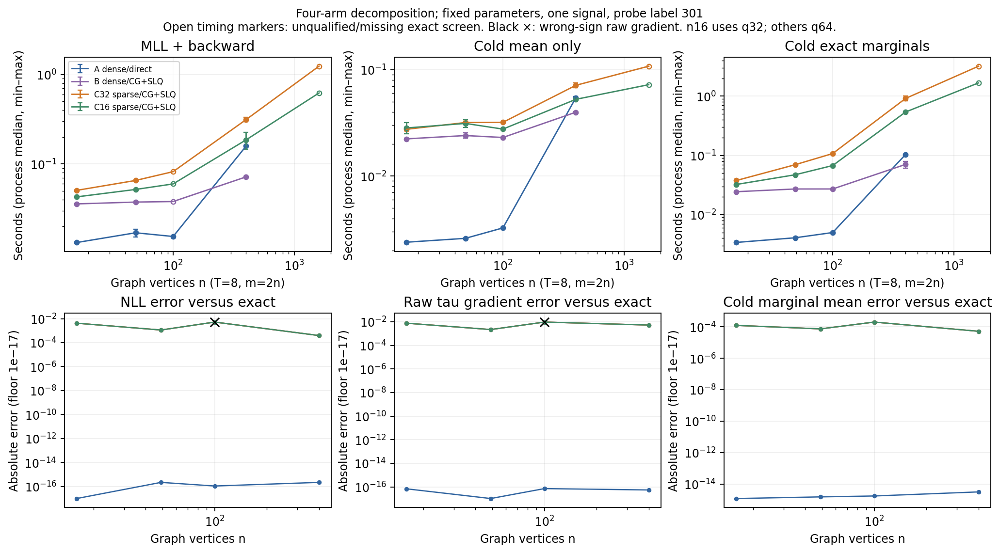
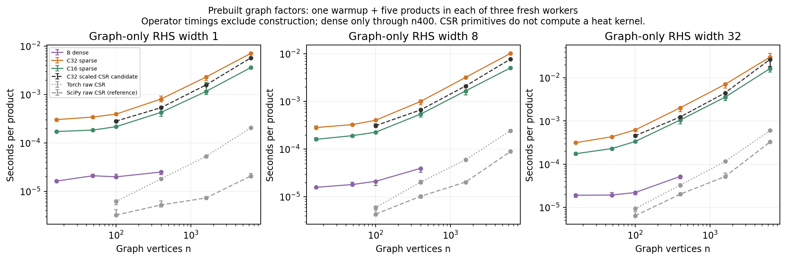
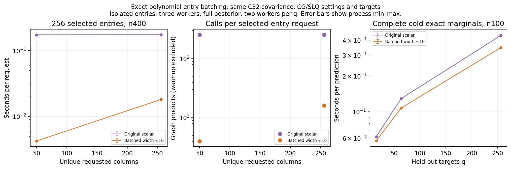

# Stage 05 — sparse Chebyshev optimization and inference decomposition

## 1. Objectives, baseline and benchmark

The study separates graph representation from inference, batches exact selected entries, tests
degree 16, and admits one profiled CSR optimization. It keeps the zero-mean, unit-amplitude
covariance exp(-tau L) ⊗ RBF(ell), vertex-major/time-minor coordinates, and independent
observation noise **variance**. The primary point is tau=1.2, ell=0.24, variance=0.06, T=8,
m=2n. No posterior variance estimator, preconditioner, custom solver, precision reduction or
inference-kernel repair was introduced.

The requested Stage 04 main was `0fec2c30578ff755088c8b6796faa856564ea2d9`; actual main was
`ac8bffe0443436d623840130609582f599824d9d`. The only intervening change removed a redundant
phrase from README's variance definition. Before source changes, 133 tests ran (132 passed, one
expected CUDA skip) and all four old smokes passed. Historical evidence hashes remain unchanged.

The clean primary measured source is `de592cfd927581a54ff78d8fd26e38b6c5f45979`. Candidate
measurements used `5421c89c2629acff0b4cc05b84bae50ba2c7bfc2`; the only subsequent change before
the primary run interleaved scalar entry controls with the four-arm GP blocks. Candidate
requests and all numerical/worker files were unchanged. Environment/source hashes, request
accounting and warnings are in [the evidence package](evidence/chebyshev_stage05/README.md).

Measurements used Apple M4, 16 GiB host memory, macOS arm64, Python 3.12.0, Torch 2.11.0,
GPyTorch 1.15.2, linear_operator 0.6.1, NumPy 2.4.3, SciPy 1.17.1 and Matplotlib 3.10.8. Each
worker forced one thread before importing the numerical stack and preloaded the same diagnostic
imports. GP timings use two independent processes through n=400 and one at n=1600/T=32. Operator
products use three processes, each with one warmup and five timed products. Headline timings
include scoped counting hooks, and exclude the diagnostic CPU profiler. No competing local test
or plotting process ran during measurements.

The one realization per n/T comes from the unchanged Stage 04 approximate-field generator,
P32(exp(-tau L/2)) Z chol(KT).T, with master seed 202605 and independent recording noise. It is
an approximate GP-like benchmark signal, not an exact-GP sample or hyperparameter-recovery
experiment. q=16/q=64/q=256 reuse training data, validation RHS and nested target prefixes.
Model build is timed given the fixed CSR input; graph generation and signal/mask preparation are
reported as data setup.

## 2. A/B/C decomposition and actual inference paths

A caches the dense graph eigensystem at construction and uses direct Cholesky. B uses that
identical dense graph model with CG/SLQ. C32 and C16 use sparse Chebyshev graph factors with the
same iterative configuration as B. Degree 32 remains the default. The primary study deliberately
keeps the original affine recurrence, so the separately admitted scaled-CSR candidate does not
confound its four arms.

Balanced settings are 16 probes, at most 32 Lanczos steps, CG/eval tolerance 1e-4, 500 maximum
iterations, no preconditioning, terminate-by-size false and exact requested marginal variances
with fast_pred_var false. Labels 301/302/303 are accuracy controls on n=16/49/100; primary
timing repeats fix label 301. Strict 1e-6 and exhaustive n=16 controls never enter primary
timing medians.

A records Cholesky calls and zero CG/SLQ calls. B's guards forbid direct Cholesky and a full
Kronecker prior, while permitting its dense graph factor. Sparse guards also prohibit dense
graph heat covariances/eigensystems. Every successful non-build sparse operation records
Chebyshev products. B/C pairing records the effective seed, requested settings, CG RHS shapes
and trace counts rather than asserting that a settings label proves the executed algorithm.

| n | Operation | A direct (s) | B dense iterative (s) | C32 (s) | C16 (s) |
|---:|---|---:|---:|---:|---:|
| 100 | Model build | 0.001788 | 0.001746 | 0.001231 | 0.001221 |
| 100 | MLL + backward | 0.015441 | 0.037982 | 0.081997 | 0.059787 |
| 100 | Three updates + final evaluation | 0.249505 | 0.280679 | 0.482119 | 0.371762 |
| 100 | Cold mean | 0.003256 | 0.023026 | 0.031954 | 0.027603 |
| 100 | Cold exact marginals | 0.004988 | 0.027132 | 0.107579 | 0.067510 |
| 100 | Warm mean | 0.000691 | 0.000742 | 0.001168 | 0.000997 |
| 100 | Warm exact marginals | 0.002370 | 0.004737 | 0.075594 | 0.040230 |
| 400 | Model build | 0.013111 | 0.011201 | 0.002019 | 0.002042 |
| 400 | MLL + backward | 0.158245 | 0.071681 | 0.313139 | 0.185845 |
| 400 | Three updates + final evaluation | 0.853052 | 0.434077 | 1.870966 | 0.945096 |
| 400 | Cold mean | 0.054380 | 0.039786 | 0.071186 | 0.052564 |
| 400 | Cold exact marginals | 0.103968 | 0.070600 | 0.917943 | 0.541353 |
| 400 | Warm mean | 0.002370 | 0.002255 | 0.002738 | 0.001907 |
| 400 | Warm exact marginals | 0.042669 | 0.031643 | 0.630803 | 0.399009 |

Times are medians of two processes; min/max are retained in summary.csv and the figure. At
n=100, B/C32/C16 MLL rows have a wrong-sign tau gradient and do not qualify as training
crossovers. At n=400 the operational fixed-point screens pass. A-to-B changes from an iterative
penalty at n=100 to an iterative benefit at n=400. B-to-C32 still adds substantial graph-action
cost. All 158 measured B/C32 GP pairs have identical data, settings, effective seed, CG RHS
shapes and trace counts.

## 3. Operator microprofile and the scaled-CSR candidate

At n=400/T=8/m=800, non-overlapping graph recurrence ranges occupied 0.16247 s of a 0.23433 s
profiled inclusive MLL/backward wall interval (69.33%). Their inclusive CPU-event fraction was
69.40%; maximum graph range nesting depth was one. CSR addmm, multiplication, subtraction and
division were leading events. This passes the predeclared >=40% gate. These instrumented
profiler times are diagnostics, not headline MLL performance. CPU-event net bytes are not peak
allocations.

Only the specified candidate was attempted: construct (L-center I)/radius using SciPy sparse
operations once, canonicalize CSR and remove exact zeros. Its resident buffer replaces the raw
graph, rather than caching both. Raw Torch CSR inputs retain the original runtime route.
Coefficient nodes retain the original spectral interval and tau remains differentiable.
Representation reconstruction, RHS batches, state reload in the same storage mode,
coefficient/tau derivatives and complete tiny GP updates with learned noise pass tests.

All 90 fresh candidate-study workers completed. Across n=400/1600/6400 and widths 1/8/32 (also
128 through n=1600), paired median speedups were 1.23–1.44x. Every medium/large tested width
improved; the same-width >=10% wall-reduction test passed in more than two sizes. Resident
graph-kernel bytes fell by 12.1%, 15.7% and 17.2% at n=400/1600/6400. Thus both regression and
<=15% extra storage gates pass. This is an **operator-level** result, not a measured full-GP
speedup for scaled CSR.

The storage metric includes CSR row/column indices and values, spectral nodes, cosine basis and
raw tau. It excludes Python objects and transient construction workspace; construction briefly
holds raw/scaled buffers. Whole-worker peak RSS includes imports, data, allocator and setup, and
is reported independently.

Graph/full-prior MVP medians at RHS width 8, in milliseconds:

| n | Torch raw CSR | SciPy raw CSR | Dense graph B | C32 graph | C16 graph | C32 full prior | C16 full prior |
|---:|---:|---:|---:|---:|---:|---:|---:|
| 100 | 0.0060 | 0.0043 | 0.0211 | 0.4030 | 0.2263 | 0.8792 | 0.4849 |
| 400 | 0.0202 | 0.0102 | 0.0395 | 0.9998 | 0.5422 | 2.8292 | 1.4255 |
| 1600 | 0.0597 | 0.0204 | — | 3.1964 | 1.6620 | 11.9093 | 6.0216 |
| 6400 | 0.2435 | 0.0890 | — | 10.2211 | 5.0827 | 68.1827 | 35.3516 |

At n=400/width 8, C32 graph autograd forward/backward took 2.500 ms, versus 1.423 ms for C16;
isolated gather/scatter took 0.0297/0.0986 ms. The full Kronecker product also expands the
effective graph RHS width (width 8 becomes 64 at T=8), so the graph/full difference is not a
measurement of the temporal factor alone. SciPy CSR is a timing reference; it is not substituted
into differentiable inference. Prebuilt dense graph products remain faster throughout the
measured matched operator range.

## 4. Exact entry batching, dispatch and posterior effect

Installed dispatch is InterpolatedLinearOperator._diagonal -> generic indexed selection ->
KroneckerProductLinearOperator._get_indices -> graph _get_indices. The original n=16/q=32
posterior sent one batch of 32 entries from 15 distinct graph columns. It did not send 32
separate scalar calls. The conditional graph-time adapter was therefore unnecessary.

The graph method now broadcasts/validates indices, groups unique columns, applies basis blocks
of at most 16, and differentiably restores the original order. Repeated vertices share work
within that entry evaluation. No cache survives it. At small n, width is bounded below n to
avoid an n-by-n basis; n<=3 retains legacy instrumentation granularity. Empty selections remain
connected to zero coefficient gradients. Values and derivatives match the old scalar method and
an independent dense polynomial. Parameter/data mutations, state reloads, chunked prediction and
mean-only variance skipping have explicit regression coverage.

For 256 entries with 50 or 256 unique columns at n=400, the original method needed 256 graph
products per request; batching needs four or 16. Temporary basis/product workspace is O(n*16),
plus entry bookkeeping. In the actual n=16 diagnostic, posterior graph products fell from 65 to
34 and the model moments stayed matched. Those before/after diagnostics share one process and do
not establish timing. The full isolated scalar controls below use the same current source,
covariance, solver settings and targets, interleaved beside their four-arm blocks.

| Isolated 256 entries | Original calls | Batched calls | Original (s) | Batched (s) | Speedup |
|---|---:|---:|---:|---:|---:|
| 50 unique columns | 256 | 4 | 0.173863 | 0.004240 | 41.01x |
| 256 unique columns | 256 | 16 | 0.174158 | 0.018121 | 9.61x |

| Complete cold C32 marginal prediction | Original (s) | Batched (s) | Elapsed reduction |
|---|---:|---:|---:|
| n=100, q=16 | 0.061685 | 0.056904 | 7.8% |
| n=100, q=64 | 0.129009 | 0.107579 | 16.6% |
| n=100, q=256 | 0.438415 | 0.346285 | 21.0% |
| n=400, q=256 | 2.511869 | 2.316252 | 7.8% |

Matched MLL and mean-only controls changed by less than 0.8% at all four q configurations, below
the 10% regression limit. Batching remains enabled. Overall marginal speedups are much smaller
than isolated entry speedups: the exact target/train solves and wide graph-time actions remain.

## 5. Degree 16: certificate, numerical and gradient effects

The unchanged analytic certificate gives interpolation remainder 7.3700665e-10, roundoff
allowance 6.4170891e-12, and positivity margin 3.3546188448e-4 over tau<=4 and spectrum [0,2].
There are 17 coefficients and nodes. Across 480 path/grid/irregular/disconnected parameter
combinations (n=9/16/49/100, five tau values through 3.95, three ell values, T=4/8, widths 1/8),
maximum degree 16 graph/full-product errors versus expm were 5.22e-11 and 1.27e-10. Dense
polynomial spectral minima were positive. Independent tau derivatives of entries/products, and
raw/physical GP tau/ell/noise gradients, passed unchanged tiny numerical gates. No negative
posterior variance was clipped.

The four-arm exhaustive n=16 NLL errors were zero for A and about 5.37e-11 for B/C32/C16. Tiny
posterior/gradient gates and three-update C16/C32 parity passed. These exhaustive controls prove
numerical compatibility, not stochastic training fidelity or scalable performance.

All 330 recorded C16/C32 pairs completed. Across fixed-point/three-update comparisons, maximum
NLL difference was 3.49e-13, raw-gradient difference 1.75e-13, posterior-mean difference
1.54e-11 and either variance difference 1.25e-13, within the predeclared 2e-4/2e-3/2e-4 gates.
These values include sparse-only pairs; their absolute exact-oracle errors remain unavailable.
At n=100, C16 reduced MLL time from 0.081997 to 0.059787 s (1.37x) and cold marginals from
0.107579 to 0.067510 s (1.59x). At n=400 those ratios were 1.68x and 1.70x. There was no hidden
degree search or default substitution.

Degree 16 remains explicit opt-in, with the finite polynomial difference disclosed. Halving
recurrence applications does not imply halving GP training time.

## 6. Training, CG/SLQ error and gradient signs

**Each iterative arm reverses the tau-gradient sign in three of the nine balanced canonical
case/probe combinations. Strict tolerance repeats the same three reversals.** These are shared
probe outcomes, not independent errors from three representations. Across B/C32/C16, both
profiles yield 18 wrong-sign rows among 54 canonical arm/profile/case/probe evaluations.
Including repeated timings and nested-q controls gives 39 fixed-MLL rows with reversals; that is
not 39 independent draws.

For example, at n=100/probe 301 the exact raw tau gradient is +0.00305512, while B/C32/C16 give
approximately −0.00633863. At n=16/probe 302, exact +0.01993137 becomes approximately
−0.01178256. Tightening CG tolerance does not fix these stochastic trace-gradient errors.
Maximum observed NLL error was 0.0300261, tau raw-gradient error 0.0317139 and ell raw-gradient
error 0.0121875. The representation/degree changes reproduce the same errors rather than
reducing their rate.

Fresh noisy-covariance relative residual maxima were 1.40665e-4 for balanced and 7.52602e-6 for
strict. Posterior-mean error through n=400 was at most 1.99029e-4 and latent/observation
variance error at most 4.98161e-8. Returned SLQ orders ranged 22–32; actual probe counts were
recorded. All 108 warning-bearing workers were strict diagnostics, with 135 numerical warnings.
No primary balanced worker emitted a numerical warning, but absence of warnings did not imply a
correct gradient sign.

The operational screen alone is deliberately loose: NLL <=0.05, raw-gradient error
<=0.02+0.20*abs(exact), posterior error <=0.01 and fresh noisy residual <=0.001. A wrong-sign
raw gradient with reference magnitude >0.001 additionally disqualifies a training crossover.
Every seed remains visible, including when B and C share the same stochastic error. Entry
batching and polynomial degree cannot be credited with repairing that error. Three Adam updates
plus one final NLL/gradient evaluation are a compatibility test, not converged training.

Actual CG iteration counts are **not measured** and remain null. Returned SLQ orders, solver
invocation counts, recurrence applications and RHS widths are reported separately. Method timers
overlap outer wall time and cannot be summed as a complete profiler decomposition. Tightening
tolerance can expose the pinned CG implementation's residual floor; no epsilon or installed
solver was patched.

## 7. Larger crossover and amortization

There is **no measured cold MLL, cold mean, or exact marginal sparse crossover** through n=400:
C32/C16 never beat both A and B on a qualified matched cold operation. There is a narrower
warm-cache mean-only crossover for C16:

| n=400 warm mean | A (s) | B (s) | C16 (s) | A/C16 | B/C16 |
|---|---:|---:|---:|---:|---:|
| q=64 | 0.002370 | 0.002255 | 0.001907 | 1.24x | 1.18x |
| q=256 | 0.005045 | 0.004950 | 0.004321 | 1.17x | 1.15x |

This warm helper reuses GPyTorch's unchanged prediction strategy after the same model's cold
call. Preparation is excluded and separately recorded for every arm. The public
predict_marginals API still resets its strategy once per call; this result does not describe its
ordinary cold-call latency. Warm mean performance does not establish faster training or marginal
variances.

At n=1600, the single C32/C16 attempts took 1.240/0.622 s for MLL, 5.429/2.714 s for three
updates plus final evaluation, and 3.216/1.680 s for cold exact marginals. No exact reference or
dense timing is available there, so no accuracy-qualified GP crossover is asserted. n=6400 was
operator-only.

At n=400/q=64, build-plus-fixed-MLL projections are:

| Arm | Build +1 MLL (s) | Build +20 MLL (s) | Build +100 MLL (s) | Actual train 3 (s) |
|---|---:|---:|---:|---:|
| A | 0.1714 | 3.1780 | 15.8376 | 0.8531 |
| B | 0.0829 | 1.4448 | 7.1793 | 0.4341 |
| C32 | 0.3152 | 6.2648 | 31.3159 | 1.8710 |
| C16 | 0.1879 | 3.7189 | 18.5866 | 0.9451 |

Build +1/20/100 fixed-parameter MLL costs in summary.csv are explicit arithmetic projections
from measured medians. They are not measured end-to-end optimization runs. Three-update timings
are separate actual three-update measurements. Dense precomputation is paid in build and reused
through subsequent parameter updates. No dense ratio is manufactured at n=1600 or n=6400.

## 8. Failures, source and memory limits

All 1,275/1,275 primary-study requests completed: zero errors, OOM indicators, signals, nonzero
exits or timeouts; all 90/90 candidate workers completed separately. The primary worker sum was
1,751.06 s (29.18 min), with 1,752.61 s coordinator wall; the candidate study used 105.44 s
worker wall. Failures remain explicit in the schema and injected failure tests, even though this
run had none.

The final suite ran 150 tests: 149 passed and the expected CUDA-unavailable test skipped. All
five stage smokes passed locally; Linux CPU CI also passed. The audit checks 95 historical file
hashes unchanged and recomputes every primary CSV byte-for-byte from raw worker results. Exactly
three figures were visually inspected and regenerated from committed CSVs.

The T=32 data factor had minimum eigenvalue −3.84949e-16, effective rank 15 at tolerance
1.58216e-11 and maximum covariance correction 4.21885e-15. All 12 secondary workers completed.
These observations concern its declared data sampler, not a new inference approximation.

Case blocks show meaningful timing variability: n=400/q=64 and q=256 have identical training
problems but different timing medians. Ratios use adjacent/interleaved controls within each
case, and min/max ranges are retained. Two timing repeats are a bounded local measurement, not a
robust hardware-independent performance guarantee. The scaled candidate's plot line comes from
its own separate interleaved microstudy; its admission ratios use that study's matched baseline.

At n=400/q=64, MLL whole-worker peak RSS medians were 436.1/306.4/314.2/310.9 MiB for
A/B/C32/C16. Much of the A-versus-sparse difference is already present in B, so it cannot all be
credited to CSR representation. Imports/setup dominate many smaller worker peaks. These RSS
differences are distinct from the candidate's persistent graph-buffer byte reduction.

The n=100/T=32 secondary is separate. It uses a declared spectral PSD square root of the
symmetrized 32-by-32 temporal covariance for data generation only, rejects substantially
negative eigenvalues and clips only tolerated roundoff negatives. Its min eigenvalue, rank and
correction are retained. No inference covariance was repaired; old Stage 04 T=32 data-generation
failures remain unchanged.

This is one CPU/software environment and one signal realization per n/T. There is no enforced
host memory ceiling beyond the planned shapes and 180-second child wall limits. Peak RSS is the
whole worker's high-water mark, with macOS bytes converted to MiB; it is not an
operator-allocation measurement. Parent initial thread count for the old unittest baseline was
not captured; baseline diagnostic and timing workers explicitly use one thread. Main and
candidate source hashes, clean-at-launch status, byte-identical CSV recomputation and historical
hashes are retained in the evidence audit. PNGs regenerate byte-for-byte from CSVs in the
recorded plotting environment.

## 9. Next single research decision

Prioritize a separately scoped **iterative-training fidelity and cost study**, including
preconditioning/logdet-gradient diagnostics, using the admitted graph options as explicit fixed
configurations. Entry batching provides exact marginal gains and degree 16/scaled CSR reduce
graph work, but the shared CG/SLQ path still gives wrong-sign gradients, wide-RHS graph-time
products remain expensive, and the cold sparse models do not beat the best matched dense
inference. The n=400 A/B reversal and narrow C16 warm-mean crossover show why each operation
needs its own qualified comparison. Keep exact marginal variances as the reference; approximate
posterior variances are not the next priority selected by this study.